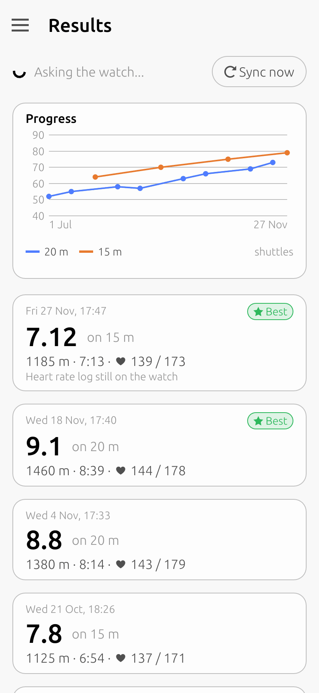
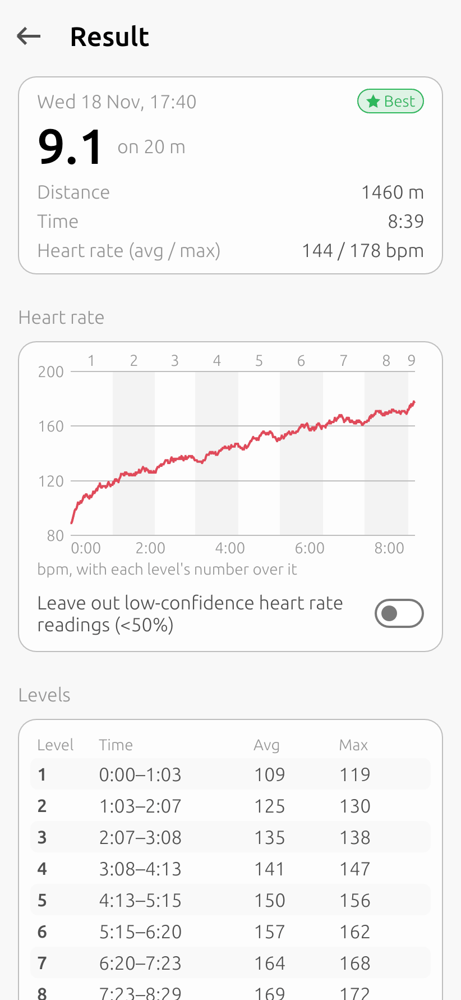

# Beep Test

The multistage fitness test ("beep test") on a 20 m or 15 m course
for Bangle.js 2, with heart rate logging you can export to your phone or fitness
service.

Tap the screen to start (the button never starts a test). The watch buzzes once at
the end of each shuttle and twice at each new level, and shows your level,
shuttle, a countdown bar to the next buzz, your heart rate and the distance so far.
Press the button for a menu: before a test it has the course, GPS speed and past
results; during a test **Back to test**, **Stop & save** and **Cancel test**.

## Install

Open [cbishopvelti.github.io/beep](https://cbishopvelti.github.io/beep/) in Chrome
or Edge, press **Connect**, pick the watch and press the install button on Beep Test.
It's the normal Bangle.js App Loader with only Beep Test on it, rebuilt from main on
every push. Other ways to install (including trying a pull request before it's
merged) are in [docs/DEVELOPMENT.md](https://github.com/cbishopvelti/beep/blob/main/docs/DEVELOPMENT.md).

## Usage

1. Mark out two lines 20 m or 15 m apart.
2. Open **Beep Test**. To change the course, press the button and pick **Course**
   (20m or 15m; it is remembered). Tap the screen to start (or choose **Start test**
   in the menu). You get a 3 second countdown (press the button to cancel).
3. Run to the other line before each cue:
   * **1 buzz**: end of a shuttle, turn and go.
   * **2 buzzes**: new level, the pace gets faster.
4. When you can no longer reach the line in time, **press the button** and choose
   **Stop & save**. The moment you pressed the button is what counts, so take your time
   in the menu. Your result is shown as `level.shuttle` (the last shuttle you completed),
   with total distance and average / max heart rate.
5. To abandon a test instead (a false start, say), choose **Cancel test**: nothing is
   saved and its heart rate log is deleted.
6. Past results are under **Results** in the menu, where you can also delete them.

### GPS speed

Turn on **GPS speed** in the menu to show live GPS speed on the test screen and record speed
and position in the log (and the TCX export). It is off by default: on 20 m / 15 m shuttles
GPS speed lags and is only accurate to a few metres, it rarely gets a fix indoors, and it
uses a lot of battery. The target speed for the level is always shown.

### Buttons

| | Short press | Long press |
|---|---|---|
| Before a test | Menu (start, course, GPS, results) | Back to the clock |
| During a test | Menu (back to test, stop & save, cancel) | Back to the clock, **test keeps running** |

While a test is running in the background, cues carry on and a **widget** on the clock
face shows the current `level.shuttle` and your heart rate. Tap the widget (or open the app
again) to get back to the full screen or to stop the test.

Bangle.js 2 has no speaker, so cues are vibrations.

The watch locks and the backlight goes off as usual during a test (the buzzes and
logging carry on), so sweaty taps can't press anything. When it's locked, the first
button press may only wake it: press again for the menu.

## Courses and timings

Both courses use the same speeds: level 1 is 8.0 km/h, level 2 is 9.0 km/h, then each
level adds 0.5 km/h up to level 21 (18.5 km/h). Each level lasts about a minute, so the
15 m course has more shuttles per level:

| Level | 1 | 2 | 3 | 4 | 5 | 6 | 7 | 8 | 9 | 10 | 11 | 12 | 13 | 14 | 15 | 16 | 17 | 18 | 19 | 20 | 21 |
|---|---|---|---|---|---|---|---|---|---|---|---|---|---|---|---|---|---|---|---|---|---|
| 20 m | 7 | 8 | 8 | 9 | 9 | 10 | 10 | 11 | 11 | 11 | 12 | 12 | 13 | 13 | 13 | 14 | 14 | 15 | 15 | 16 | 16 |
| 15 m | 9 | 10 | 11 | 12 | 12 | 13 | 13 | 14 | 14 | 15 | 15 | 16 | 17 | 17 | 18 | 18 | 19 | 19 | 20 | 20 | 21 |

* **20 m** is the standard multistage fitness test (Léger / UK beep test).
* **15 m** follows the FitnessGram 15 m PACER lap counts.

Cue times are worked out from the test start time, so they do not drift, even when you
switch apps. If the watch goes flat or restarts during a test, the test is saved as it
stood when the watch stopped logging, the next time it's on.

## Heart rate log and export

While the test runs, the watch writes one line a second to a `beeptest.<time>.csv` file
with elapsed time, heart rate, HRM confidence, level, shuttle and distance (plus GPS
speed and position when that's on). It keeps
logging while you're on the clock face.

The [phone app](#phone-app-android) copies it to your phone by itself. Without it, to get
it off the watch, connect in the App Loader you installed from,
find **Beep Test** under *My Apps* and click its **download (interface) icon**. Each test
can be downloaded as:

* **TCX** (Garmin Training Center XML): a standard activity format with time, distance
  and heart rate, split into one lap per level. Upload it to Strava (*Upload activity → File*),
  Garmin Connect (*Import data*), Runalyze, Intervals.icu, Golden Cheetah, or open it in
  most phone fitness apps. Without GPS speed it shows as an indoor run.
* **CSV** for spreadsheets.

Both end at the moment you pressed the button to stop. A test that is still running on
the watch shows as *In progress*: you can download it so far, but not delete it.

There is an option to drop low-confidence HR readings. The wrist HRM struggles with the
arm movement of hard running; for better data pair a chest strap with the
[BTHRM](https://banglejs.com/apps/?id=bthrm) app, which this app picks up automatically.

Make sure the watch's clock is set (the App Loader sets it when you connect) so the
exported activity has the right date.

## Phone app (Android)

The Beep Test phone app keeps every result and heart rate log on your phone, and stays in
sync with the watch:

* Results and their heart rate logs come off the watch by themselves. The phone keeps them
  all (the watch only keeps its last 30).
* A result deleted on either side is deleted on both.
* The watch's course and GPS speed can be changed from the phone (the **Watch** page).
* Each result has a heart rate chart with the levels marked, a table with a row per level,
  and **Share TCX** and **Share CSV** (to Strava, Garmin Connect, a mail, ...), with the same
  option to leave out low-confidence readings as the download page.

It needs Android 8 or later and Beep Test 0.05 or later on the watch. It is new: it hasn't
yet been tried on a real phone, so expect rough edges, and please report them as issues on
GitHub.

### Getting it

The app isn't in an app store. Download `beep-android.apk` from the
[android-latest](https://github.com/cbishopvelti/beep/releases/tag/android-latest) release on
the phone (it's rebuilt from main whenever the app changes) and open it. Android asks you to
allow installing apps from your browser or file manager the first time. A newer APK installs
over an older one and keeps your results.

To try a pull request before it's merged, open its **Android app** check on GitHub, then
**Summary**, and download `beep-android-apk` under *Artifacts* (you need to be signed in to
GitHub). It's a zip with `beep-android.apk` in it.

### Connecting to the watch

**Through Gadgetbridge** (the usual way, if the watch is already paired with
[Gadgetbridge](https://gadgetbridge.org/)):

1. In Gadgetbridge, open the Bangle.js's settings (the gear on its card) and turn on
   **Allow Intents**. Beep Test's messages go through Gadgetbridge as intents, both ways.
2. Open the Beep Test app once. Android doesn't pass messages to an app that has never been
   opened; after that the watch can reach it even when it's closed.

**Directly, without Gadgetbridge**: in the app's **Settings**, turn on **Connect to the watch
directly, without Gadgetbridge**, allow "Nearby devices" (location on Android 11 and earlier),
and pick the watch from the list. The watch takes one phone connection at a time, so disconnect
it in Gadgetbridge first. While it's connected the app shows a quiet notification, which keeps
it connected when the app is closed.

### What syncs and when

The app syncs when you open it, when you press **Sync now**, and whenever the watch has
something new for it: a test starting or ending, a result deleted, the course or GPS speed
changed on the watch, or the phone connecting. So with the phone connected, a test's result
shows on the phone a few seconds after it ends, and its heart rate log follows (the card says
"Heart rate log still on the watch" until it has arrived). While a test is running on the
watch nothing is copied, so the cues are never delayed: the sync carries on when the test
ends.

A result deleted on the phone (it asks first; there's no undo) is deleted on the watch
straight away if it's connected, or else at the next sync. A result deleted on the watch (its **Results** menu, or the App Loader's download
page) is deleted on the phone the next time they sync. A result the watch drops to make room
for newer ones stays on the phone.

## More

- Source, issues and development builds: [github.com/cbishopvelti/beep](https://github.com/cbishopvelti/beep)
- Developing and testing: [docs/DEVELOPMENT.md](https://github.com/cbishopvelti/beep/blob/main/docs/DEVELOPMENT.md)
