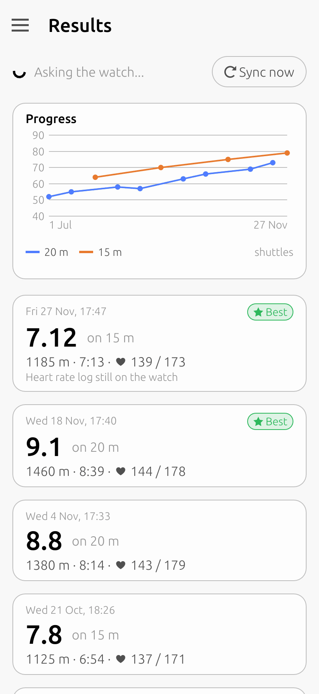
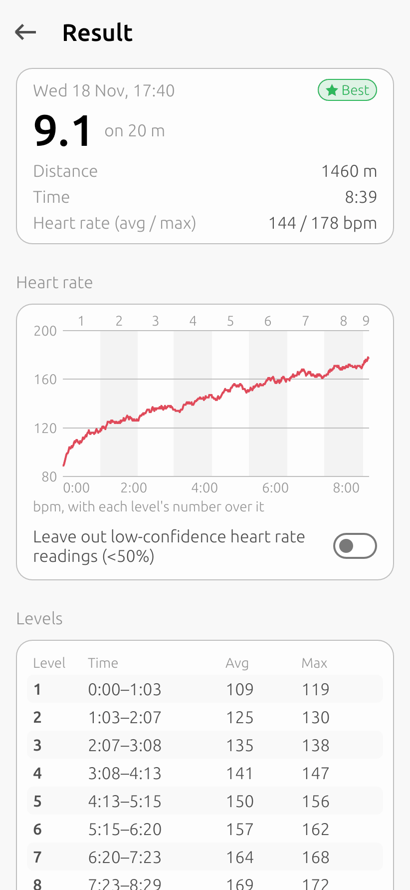

# Beep Test for Android

The phone app, written in Rust: an [egui](https://github.com/emilk/egui) UI (through eframe, on a
`NativeActivity`), built the way blink's phone app is. It keeps the phone and the watch in sync:
results and heart rate logs come off the watch by themselves, a delete on either side deletes on
both, and the watch's course and GPS speed setting can be changed from the phone. Everything is
kept in plain files in the app's files directory, and the phone is the long-term store (the watch
only remembers its last 30 results). There's no server and no account.

The pages, from the menu (from the desktop build with demo data; more in `screenshots/`):

<p>


</p>

| File | What |
| --- | --- |
| `src/lib.rs` | `android_main`, the entry the NativeActivity calls, and `app()` for the desktop; the module map. |
| `src/link.rs` | The watch link's wire format, from the phone's side: the lines it sends (`beeptest-sync`, `beeptest-get`, `beeptest-set`), the watch's events (`state`, `log`, `logend`, `busy`) checked before anything uses them (`parse_event`), an intent message read off the console for the direct link (`extras_from_line`), the history (`parse_history`) and the CRC32. |
| `src/sync.rs` | The sync engine: given the store and an input (the app opened, Sync now, the direct link coming up, a watch event, a tick, a delete, a setting changed), it updates the store and says which lines to send. It has no JNI, threads or clock of its own, so it's all tested on the desktop. |
| `src/store.rs` | The files: `results.json` (every result, the tombstones of deleted ones, the watch's history as last fetched), `logs/`, `watch.json`, `app.json`, `health/`, `exports/`. Every write is atomic (a temp file, then a rename). |
| `src/beeplog.rs` | A port of the watch's `beeplog.js`: reads a log, and writes TCX or CSV byte for byte as `beeplog.js` does. Also the rows and the heart rate series the result page draws. |
| `src/tables.rs` | The level tables, as the watch's `lib.js` has them: speeds, shuttles a level on each course, where a test is at a time, and the result it scores. |
| `src/health.rs` | When the watch was last heard from and last synced (files in `health/`), how long ago that was in words, and times in the phone's time zone. |
| `src/watch_ble.rs` | The direct link to the watch, without Gadgetbridge (Settings, off by default): the setting (in `watch.json`), what Settings and Watch say about it, and the bytes on the wire (writes in MTU-sized pieces with the watch's XON/XOFF, what it prints read back a line at a time, the clock line). See "The watch without Gadgetbridge" below. |
| `src/platform/mod.rs` | The process's one store and sync engine: every input goes through `platform::dispatch`, which runs it under one lock and sends the lines it returns. The desktop's versions of the platform calls (they log). |
| `src/platform/android.rs` | Android over JNI: sending a line (the Gadgetbridge broadcast, or the direct link), `WatchReceiver`'s broadcast (which needs no UI: the process may have started just for it), `BootReceiver`, the share sheet, the theme and the system bars, the back key on Results (`leave`), the safe area and the density. |
| `src/platform/android/ble.rs` | The direct link's Bluetooth calls, ported from blink's: the GATT connection to the watch's UART service (`WatchGatt` reports it), the scan for watches (`WatchScan`), and `WatchService`, the foreground service that keeps it while the app is closed. |
| `src/platform/android/ui_loop.rs` | blink's event loop wrapper, which lets the loop sleep while the app is in the background (eframe 0.33 would otherwise spin a CPU core), and syncs when the app comes back to the front. |
| `src/ui.rs` | The shell around the pages, as blink's: the theme and fonts, the cards and buttons, the header and the slide-out menu, the back key (the menu, then a pop-up, then back to Results; on Results it moves the app to the background, `platform::leave`), the safe area, and `Input::Opened` and `Input::Tick` for the sync engine. |
| `src/ui/results.rs` | Results, the first page: the running-test banner, what the sync is doing with Sync now, the progress chart, and a card per result, newest first, with "★ Best" on each course's best. With no results, how to connect the watch. |
| `src/ui/result.rs` | A result: the summary, the heart rate chart with the levels, the levels table, the "<50%" option, Share TCX and Share CSV, and Delete (asks first). A log that hasn't arrived, or that the watch doesn't have, gets a card saying why instead. |
| `src/ui/watch.rs` | Watch: how it's connected, when it was last heard from and last synced, the watch app's version, Sync now, and the watch's course and GPS speed (sent with `beeptest-set`, shown as the watch has them once it answers). |
| `src/ui/settings.rs` | Settings: the theme (light, dark or the phone's, which also sets the system bar icons), "Connect to the watch directly, without Gadgetbridge" with the permission request and the watch picker, and the app's version. |
| `src/ui/chart.rs` | The two charts, the progress chart and the heart rate over a test, drawn with egui's painter; the scaling is apart from the drawing so it's tested. |
| `src/ui/status.rs` | From blink: the Watch page's rows (a dot, a name and a few words, opening for the rest). |
| `src/ui/dialog.rs` | From blink: the look every pop-up shares (Delete's confirm, the watch picker). |
| `src/ui/toggle.rs` | From blink: the on/off switch row. |
| `src/ui/chip.rs` | From blink: the small outlined chips ("★ Best", "20 m" / "15 m", "Change" and "Allow"). |
| `src/ui/demo.rs` | Demo data written through the store: a dozen results over five months with heart rate logs as the watch writes them (the desktop's `--demo`, and the UI tests). The phone never calls it. |
| `src/bin/desktop.rs` | The same app in a desktop window, for working on it without a phone: `--demo` fills the data directory with demo results, and `BEEP_PAGE`, `BEEP_THEME`, `BEEP_SIZE` and `BEEP_SHOT` open a page and save a screenshot (below, and at the top of the file). |
| `tests/sync.rs` | The sync engine against a fake watch (`sync.js` as the phone sees it) over a link that loses, repeats and reorders lines, with the app killed, the watch going back to the clock mid-transfer, and forged events; `BEEP_SEEDS=500` runs more seeds. |
| `tests/fixtures.rs` | The lines shared with the watch's tests (`tests/fixtures/` at the repo root; see "Shared fixtures" below). |
| `tests/beeplog.rs` | The log port against the files `beeplog.js` wrote (`tests/fixtures/beeplog/`). |
| `tests/ui_result.rs`, `tests/ui_watch.rs` | The pages clicked through headlessly (`egui_kittest`, no pixels) on the demo data: a result, sharing, deleting and the back key; the menu, the Watch page's settings waiting for the watch's answer, the running-test banner, and the theme. |
| `app/src/main/java/com/cbishopvelti/beep/WatchReceiver.java` | Gadgetbridge's broadcast of the watch's events (`com.cbishopvelti.beep.WATCH`), handed to Rust. |
| `app/src/main/java/com/cbishopvelti/beep/BootReceiver.java` | After a reboot or an update of the app: Rust starts `WatchService` again if the direct link is on. |
| `app/src/main/java/com/cbishopvelti/beep/WatchGatt.java` | The direct link's GATT callbacks (connection, MTU, services, descriptor, write done, data from the watch), each straight to Rust. |
| `app/src/main/java/com/cbishopvelti/beep/WatchScan.java` | The scan for watches while Settings' picker is open: each named device's address, name and signal to Rust. |
| `app/src/main/java/com/cbishopvelti/beep/WatchService.java` | The foreground service that keeps the direct link while the app is closed; tells Rust when it starts and stops. |
| `app/src/main/java/com/cbishopvelti/beep/ThemeStub.java` | Sets the status and navigation bar icons dark or light, on Android's UI thread. |
| `app/src/main/java/com/cbishopvelti/beep/MainActivity.java` | The `NativeActivity` the launcher opens; its `onDestroy` ends the process (see "The Java side" below). |
| `app/` | The Gradle project that packages `libbeep_android.so` into an APK: the manifest, the icons, `res/xml/file_paths.xml` for the share sheet, and `debug.keystore`. |
| `screenshots/` | The pages on the desktop with the demo data (Results, a result, Watch, Settings, and Results in the dark theme). |
| `fonts/` | Ubuntu Medium, for headings (UFL, `fonts/UFL.txt`), as blink's. |

The Java classes are stubs, the only Java: Android delivers broadcasts, the Bluetooth callbacks and
the service's start to classes named in the manifest, which Rust can't define. Each passes what it
gets straight to Rust and holds no logic.

## Building

You need Rust (stable, 1.88 or later, as egui 0.33 does), and for the APK the Android SDK with NDK
27.2.12479018 and platform 36, JDK 17 or later, and [cargo-ndk](https://github.com/bbqsrc/cargo-ndk).
The APK runs on Android 8.0 (API 26) and later.

```sh
cd android
cargo test                 # the sync engine, the store, the log port and the pages, on the desktop
cargo run                  # the app in a desktop window, data in ./beep-data (or $BEEP_DATA)

rustup target add aarch64-linux-android x86_64-linux-android
cargo install cargo-ndk
export ANDROID_HOME=~/Android/Sdk          # or write sdk.dir to local.properties
./gradlew installDebug                     # builds the Rust library, then the APK, and installs it
./gradlew assembleDebug -PrustTargets=arm64-v8a   # one ABI only, for a faster loop
```

The APK is `app/build/outputs/apk/debug/app-debug.apk`. Logs: `adb logcat -s beep`.

Builds are signed with `app/debug.keystore`, the repo's own debug key (alias `androiddebugkey`,
password `android`, as Android's own debug keys are), so an APK built on any machine installs over
one built on another without uninstalling, which would lose the phone's results.

GitHub builds it too (`.github/workflows/android.yml`, on every pull request and push to main that
changes `android/`, `tests/fixtures/` or the workflow): the desktop checks, then the APK, kept as
the `beep-android-apk` artifact of each run (a zip with `beep-android.apk` in it, on the run's
page under Artifacts). Each such push to main also puts it on the `android-latest` prerelease, so
the newest build is always at
https://github.com/cbishopvelti/beep/releases/download/android-latest/beep-android.apk.

Checks before pushing, from `android/`:

```sh
cargo fmt --check && cargo clippy --all-targets -- -D warnings && cargo test
```

The Android-only code (`src/platform/android*`) isn't compiled on the desktop. It type-checks
without the SDK or NDK, since that needs only Rust's standard library for the target:

```sh
rustup target add aarch64-linux-android
cargo check --target aarch64-linux-android --lib
cargo clippy --target aarch64-linux-android --lib -- -D warnings
```

### The desktop app and its demo data

`cargo run` opens the app in a window, with its data in `./beep-data` (or `$BEEP_DATA`). There's no
watch there: the lines for it are logged (`RUST_LOG=info cargo run`), so a sync asks and, 10 s
later, says the watch isn't answering. `--demo` first fills the data directory with a dozen results
over the last five months on both courses, each with a heart rate log written as the watch writes
it: one with GPS speed, the newest one's log half arrived, and an old one with none. `--running`
adds a test running on the watch. Use a directory of its own:

```sh
BEEP_DATA=/tmp/beep-demo cargo run -- --demo
BEEP_DATA=/tmp/beep-demo cargo run -- --demo --running
```

For a screenshot without looking (`xvfb-run` on a machine with no display), `BEEP_PAGE` opens a page
(`results`, `result`, `result-gps`, `result-arriving`, `result-nolog`, `delete`, `menu`, `watch`,
`watch-sending` or `settings`), `BEEP_THEME` is `light` or `dark`, `BEEP_SIZE` is the window in
points (`411x891`, a phone's, by default), and `BEEP_SHOT` is the PNG to write a second after it
opens, after which it quits. `screenshots/` was taken this way, at twice the scale, then cut to
128 colours to keep each file small:

```sh
BEEP_DATA=/tmp/beep-demo BEEP_PAGE=result BEEP_THEME=light BEEP_SHOT=result.png \
  WINIT_X11_SCALE_FACTOR=2 xvfb-run -a -s "-screen 0 1280x2000x24" cargo run -- --demo
```

`BEEP_BLUETOOTH=off` makes Settings act as if Bluetooth wasn't allowed.

## Version

The version is Cargo.toml's (`0.1.0`), which Gradle also makes the APK's `versionName`; Settings
shows it. The `versionCode` is the minute the APK was built instead: Android won't install over a
higher code, so this way any newer build installs over an older one, whichever branch it came from.
There's no build number: change the version in Cargo.toml when a change is worth one.

## Reaching the watch

The messages both ways, and what the watch does with them, are in `docs/DEVELOPMENT.md` at the repo
root ("The watch link"). This is the phone's side.

**Through Gadgetbridge** (the default). Turn on "Allow Intents" in Gadgetbridge's settings for the
Bangle.js, and open the app once after installing it: Android delivers no broadcasts to an app that
has never been opened. The app sends each line as Gadgetbridge's `com.banglejs.uart.tx` broadcast
with the extra `line`, which Gadgetbridge writes to the watch. The watch's events come back as
Gadgetbridge broadcasts of `com.cbishopvelti.beep.WATCH` to `WatchReceiver`, which Android delivers
even with the app closed, starting its process if need be. `WatchReceiver` hands the intent to Rust,
which opens the store from the files directory (if the process has just started), reads the extras
the events can have (`link::EXTRAS`), checks them (`link::parse_event`) and runs the event through
the sync engine; any line that answers it (the next `get`, say) goes out from there, with no UI.

**When it syncs**: when the app opens or comes back to the front, on **Sync now**, after a delete on
the phone, when the direct link connects, and whenever the watch says `state` (which it does by
itself when a test starts or ends, a result is deleted on it, its settings change, a phone connects,
or going back to the clock cut a transfer off). A sync is a `beeptest-sync` line, which carries the
deletes the watch hasn't done yet, and the watch answers `state`. Then:

- The phone saves what the watch said (its version, course, GPS speed, the running test) and
  deletes every result the watch says was deleted on it, with its log. While a test is running on
  the watch that's all: the watch would answer any `get` with `busy`, and it says `state` again
  when the test ends, which starts the next round.
- If the watch's history isn't the one the phone last fetched whole (`hist`, its length and CRC),
  it's fetched again (`beeptest-get` `beeptest.json`), and taken in only when it arrived whole and
  its CRC matches: new results are added, known ones updated, and results the watch no longer
  lists are kept. A result deleted on the phone never comes back, and a delete stays pending until
  the watch's history no longer lists it.
- Then each result whose log isn't on the phone yet, one at a time, not the running test's: it's
  asked for from the size of what's already here (`logs/<f>.part`), so a transfer cut off (the app
  killed, the watch out of range) carries on where it stopped. Each piece is appended only if it's
  the next one and its CRC is right; a broken or short transfer is asked for again, at most 3 times
  a file a round, and a transfer that stops for 10 s while the app is open counts as broken. A
  complete log is renamed to `logs/<f>`. A `logend` shorter than what's here (the watch's file
  isn't the one the partial came from) drops the partial, and the log is asked for from the start;
  `len` `-1` marks the result as having no log, which isn't asked for again.
- `busy` (a test started on the watch mid-round) stops the round: the watch says `state` when the
  test ends, which starts the next.
- A `beeptest-sync` that gets no `state` within 10 s while the app is open shows as "The watch isn't
  answering" on Results and Watch.
- A delete on the phone stays pending (in every `beeptest-sync`) until the watch is seen without
  it: a history fetched that doesn't list it, or a `state` whose `hist` is the history last
  fetched when that doesn't list it (a result the watch had already forgotten leaves its
  history as it was).
- Deleting the result whose log is being fetched ends the round; the watch's answer to the sync
  starts the next (or the pages say it isn't answering). A log that can't be marked as having
  none (the phone's storage full, say) is given up on for the round rather than asked for again
  at once.
- The 10 s waits count from the phone's clock as it is when they're checked, so a clock set back
  doesn't stop them.

Everything the phone needs to carry on is on disk, so a round interrupted by the app being killed
carries on at the next `state` or sync. Since the receiver is exported (Gadgetbridge has to reach
it), any app on the phone can send it an intent: file names must be the watch's
(`beeptest.<digits>.csv` or `beeptest.json`), a log is refused past 4 MB and the history past 64 KB,
`state`'s `del` past 30 names (as many as the watch remembers), and numbers must parse.

### The watch without Gadgetbridge

Settings has **Connect to the watch directly, without Gadgetbridge**, off by default. On, the phone
app is the watch's Bluetooth central itself and Gadgetbridge isn't needed, as in blink
(`src/watch_ble.rs`, `src/platform/android/ble.rs`). Nothing changes on the watch: it's the same
Nordic UART service and the same lines Gadgetbridge writes and reads. The watch takes one phone
connection at a time, so Gadgetbridge has to let go of it first (disconnect it there).

- **Turning it on** asks for "Nearby devices" (`BLUETOOTH_SCAN`, without location, and
  `BLUETOOTH_CONNECT`) on Android 12 and later, with notifications on 13 and later so the service's
  notification shows. Android 11 and earlier only find Bluetooth devices for an app with location,
  so there it asks for that instead (the manifest asks for location on those versions only). It
  opens a pop-up that scans for `Bangle.js ...` watches, nearest first; tap one. A watch connected
  to Gadgetbridge (or anything else) doesn't advertise, so it isn't listed until Gadgetbridge lets
  go of it.
- **The connection** is `connectGatt` with `autoConnect`, so Android connects whenever the watch is
  about, and again after it goes out of range. It asks for a 131-byte MTU, finds the UART service,
  turns notifications on, and is up. A timer checks every 20 s while it's wanted, for Bluetooth
  turned back on or the permission granted later, and sends the clock again after a time zone
  change or the clock being set, as Gadgetbridge does.
- **While the app is closed**, `WatchService` (a `connectedDevice` foreground service, started by
  the app and by `BootReceiver` after a reboot or an update) keeps the app running with a quiet
  "Connected to your watch" notification in its own channel, as Gadgetbridge's own service does.
- **On connecting** the phone writes what Gadgetbridge does first: a Ctrl-C on its own (the
  console drops what comes in the same write as one), then 0.3 s later
  `setTime(...);E.setTimeZone(...)`, and then it syncs.
- **Writes** go in MTU-sized pieces, one at a time, each waiting for the last
  (`onCharacteristicWrite`), and stop while the watch says XOFF until XON. A line while the watch
  isn't connected goes to Gadgetbridge instead, as in blink: the watch may still be Gadgetbridge's,
  and the link syncs once it's up.
- **Reads**: what the watch prints is split into lines, and an intent message for
  `com.cbishopvelti.beep.WATCH` goes through the same code as `WatchReceiver`'s broadcast. Anything
  else the console prints is ignored.

## Sharing an export

**Share TCX** and **Share CSV** on a result write the file to `exports/` in the files directory
(`Store::export`) and open Android's share sheet: `ACTION_SEND` with a `content://` uri from the
app's `FileProvider` (androidx.core's, authority `com.cbishopvelti.beep.files`, which hands out
`exports/` and nothing else, `app/src/main/res/xml/file_paths.xml`) and the read permission for the
app picked, in the chooser. On the desktop the file stays in `beep-data/exports/`.

## The Java side

Each stub's native methods and the Rust functions they land in (names as JNI mangles them:
`Java_com_cbishopvelti_beep_<Class>_<method>`). Each class with native methods loads
`libbeep_android.so` first.

| Class | Java | Rust |
| --- | --- | --- |
| `WatchReceiver` (a `BroadcastReceiver`, `com.cbishopvelti.beep.WATCH`) | `nativeWatch(Context, Intent)` | `platform/android.rs` |
| `BootReceiver` (`BOOT_COMPLETED`, `MY_PACKAGE_REPLACED`) | `nativeBoot(Context)` | `platform/android.rs` |
| `WatchGatt` (a `BluetoothGattCallback`) | `nativeState(BluetoothGatt, int status, int state)`, `nativeMtu(BluetoothGatt, int mtu, int status)`, `nativeServices(BluetoothGatt, int)`, `nativeDescriptor(BluetoothGatt, int)`, `nativeWritten(BluetoothGatt, int)`, `nativeChanged(BluetoothGatt, byte[])` | `platform/android/ble.rs` |
| `WatchScan` (a `ScanCallback`) | `nativeFound(String address, String name, int rssi)` | `platform/android/ble.rs` |
| `WatchService` (a foreground `Service`) | `nativeStarted(Service)`, `nativeStopped()` | `platform/android/ble.rs` |
| `ThemeStub` | none: Rust calls its static `lightBars(Activity, boolean)` | `platform/android.rs` |
| `MainActivity` (the `NativeActivity`, the manifest's launcher) | none: its `onDestroy` ends the process | none |

**Why `MainActivity`.** `NativeActivity.onDestroy` blocks Android's main thread until
`android_main` returns, and it never does: winit 0.30 drops `onDestroy`, and it allows one event
loop per process, so `android_main` couldn't run again in that process anyway. When the activity
is destroyed and the process lives on (swiped away in Recents while `WatchService` keeps the
process, or a configuration change), the main thread would hang, and every broadcast with it,
until Android killed the app for not answering. So `MainActivity` ends the process first.
`WatchService` is `START_STICKY`, so Android starts it again in a new process, and the next launch
gets a new process too. The manifest's `configChanges` lists every change the window takes as it is
(size, font scale, locale, dark mode, ...), so those don't destroy the activity at all. Back on
Results doesn't either: winit reports every key as handled, so Android wouldn't act on it, and
the app calls `moveTaskToBack` itself (`platform::leave`), which keeps the activity.

Everything else is Rust calling Android's own classes over JNI, from whatever thread it's on
(attached to the JavaVM for good), loading the app's own classes and androidx's `FileProvider`
through the app's class loader, since a native thread's `FindClass` only sees Android's.

## Shared fixtures

The phone's tests and the watch's read the same files in `tests/fixtures/` at the repo root, so a
change on one side that the other doesn't expect fails a test:

- `phone-lines.txt`: one of each line the phone sends, exactly as `link.rs` builds them.
  `tests/fixtures.rs` fails when the file is out of date; `BEEP_BLESS=1 cargo test --test fixtures`
  writes it again, and then the watch's `tests/fixtures.test.js` checks the watch reads every line.
- `watch-lines.txt`: what the watch printed for a scripted exchange, written by the watch's tests
  (`BEEP_BLESS=1 node tests/run.js tests/fixtures.test.js` at the repo root). `tests/fixtures.rs`
  feeds it through `link.rs` and the sync engine and checks the results and logs it leaves.
- `beeplog/`: logs, and the TCX, CSV and result text `beeplog.js` makes of them
  (`node tests/fixtures/beeplog/make.js` makes them again after a change to `beeplog.js`), which
  `tests/beeplog.rs` compares the port with, byte for byte.

## What has been tested

**Nothing has run on a real phone yet, or against a real watch or Gadgetbridge.** The APK hasn't
been built here either: the Android SDK can't be fetched where this was written, so the first build
is GitHub's workflow's.

What was checked without them:

- On the desktop: `cargo test` (the sync engine against a fake watch over a lossy link, the store,
  the link's lines and checks, the log port byte for byte against `beeplog.js`, and the pages
  clicked through headlessly), and every page looked at in both themes, at 411 and 360 points wide.
- The watch's side, in the emulator (`npm test` at the repo root), including the shared fixtures:
  the watch reads every line the phone builds, and the phone's sync engine takes what the watch
  printed for a scripted exchange and stores the right results and logs.
- The Android code type-checks for `aarch64-linux-android` and `x86_64-linux-android` and passes
  clippy, and a static build of the library for `aarch64-linux-android` exports
  `ANativeActivity_onCreate`, `android_main` and every `Java_com_cbishopvelti_beep_*` function.
- The Java stubs compile (`javac` against Robolectric's `android-all` jar for Android 16), the
  headers `javac -h` writes from them match the Rust functions' names and parameters, and every
  Android method and field the Rust calls (85 calls) was checked by name, signature and
  static-ness against that jar's classes. Only `FileProvider.getUriForFile`, which is androidx's,
  wasn't (its documented signature is used).

What to check first on a phone, in this order (`adb logcat -s beep` shows what the app does):

1. **It installs and opens**: the icon, the Results page with its empty-state words, the status and
   navigation bars clear of the page and their icons readable in both themes, the menu, and Back
   (closes the menu, then back to Results, then the app goes to the background and opens again
   where it was).
2. **Gadgetbridge, phone to watch**: with "Allow Intents" on, Sync now reaches the watch (the
   first `adb` line in `docs/DEVELOPMENT.md`'s "Trying it by hand" does the same by hand), and
   Gadgetbridge shows no "Malformed JSON" pop-up.
3. **Gadgetbridge, watch to phone**: the watch's `state` arrives (Watch says when it was last heard
   from), then the results and their logs, with "Fetching 1 of N logs..." on Results.
4. **With the app closed** (swiped away, not force-stopped, which stops Android delivering
   broadcasts to it until it's opened again): finish a test on the watch; its result and log are
   there when the app next opens. Delete a result on the watch: it goes from the phone.
5. **Delete on the phone**: the result goes from the watch's Results menu at the next sync.
6. **Watch page**: 15 m and GPS speed reach the watch's start screen and show on the phone once it
   answers.
7. **Share TCX and Share CSV**: the share sheet opens and the file arrives whole in another app
   (Strava, Drive, a mail).
8. **The direct link** (Settings): the permission requests on Android 12 and later (and location on
   11 and earlier), the picker lists the watch once Gadgetbridge lets go of it, the connection comes
   up with its notification, syncs, survives the app being swiped away and a reboot, and comes back
   after the watch goes out of range.
9. **`MainActivity` ending the process** when the activity is destroyed: Android starts
   `WatchService` again, and the app opens again cleanly.
